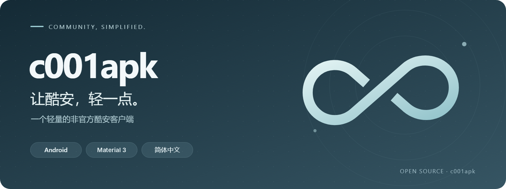

<div align="center">



# c001apk

**轻量、简体中文的非官方酷安 Android 客户端**

[](https://github.com/ZaiLinn/c001apk/releases/latest)
[](https://github.com/ZaiLinn/c001apk/actions/workflows/android.yml)

[](LICENSE)

[下载](https://github.com/ZaiLinn/c001apk/releases/latest) · [更新日志](CHANGELOG.md) · [反馈问题](https://github.com/ZaiLinn/c001apk/issues)

</div>

## 简介

c001apk 是一个第三方酷安客户端，只提供 Android 版。基于 基于 [c001apk-flutter](https://github.com/bggRGjQaUbCoE/c001apk-flutter) 继续维护，它用 Kotlin 和 Jetpack Compose 原生编写，
界面采用 Material 3 Expressive，安装包约 4 MB，界面全中文，没有广告。

## 功能

**浏览**
- 首页动态、热门、话题、数码、酷图，以及已安装应用的酷安更新
- 动态、文章、评论与楼中楼，用户空间、话题、产品与应用详情
- 动态、应用、用户与话题搜索
- 大图查看、缩放与保存

**账号**
- 账号密码登录与网页登录，支持人机验证
- 多账号保存与一键切换，也可以游客模式浏览
- 点赞、回复、发布图文动态，私信与通知
- 本地关注与悄悄关注，名单只存在本机

**个性化**
- 动态取色或固定配色、深色模式、字体大小
- 浏览历史、本地收藏，可选返回首页时自动刷新

**内容过滤**
- 在 设置 → 内容过滤 中统一管理用户黑名单、话题黑名单和敏感话题
- 敏感话题可以折叠成一行（点击即可展开），也可以直接隐藏、完全不显示
- 内置晒对象、相亲恋爱、性压抑/擦边、两性对立四类，关键词、话题、句式和语义例句都可以编辑，也可以新建分类
- 可选的 **语义屏蔽**：按需下载约 34 MB 的中文语义模型，按意思判断换了说法的帖子
  - 全部在本机运行，内容不会上传；不用时可以删除

## 安装

1. 打开 [最新版本](https://github.com/ZaiLinn/c001apk/releases/latest)。
2. 下载 `c001apk-<版本>-android-universal.apk` 并安装。

支持 Android 7.0 及以上的所有设备。应用会自动检查新版本，可在 设置 → 存储与更新 中关闭。

## 风险提示

> [!IMPORTANT]
> 这是非官方客户端，请在了解以下风险后使用。

- **接口非官方、随时可能失效**：本应用调用酷安未公开的接口，并模拟官方客户端的版本号与请求签名。酷安一旦更改签名算法、接口或风控策略，相关功能会立即失效，需要等待应用更新跟进。签名所模拟的版本号也会随官方版本变化。
- **账号可能被限制**：频繁请求或被酷安识别为非官方客户端，可能触发风控，导致人机验证、功能受限，甚至影响账号。请合理使用，自行承担风险。
- **部分内容受服务端限制**：评论列表、动态详情等接口常被要求人机验证，且验证通过后酷安服务端仍可能不接受本客户端的验证结果。此时应用会退回到不需要验证的热门评论，并在界面中说明；完成人机验证不保证服务端解除其他限制。

## 自行构建

```bash
./gradlew :app:assembleDebug
```

需要 JDK 21 和 Android SDK 37。测试、签名与发版流程见 [开发指南](docs/DEVELOPMENT.md)。

## 反馈与贡献

欢迎提交 [Issue](https://github.com/ZaiLinn/c001apk/issues) 或 Pull Request。反馈问题请附上应用版本、
Android 版本和复现步骤，不要附带密码、Cookie、Token 或私信内容。

## 致谢与许可

- 源自 [bggRGjQaUbCoE/c001apk-flutter](https://github.com/bggRGjQaUbCoE/c001apk-flutter)
- 协议调研参考 [daimiaopeng/coolapk-desktop](https://github.com/daimiaopeng/coolapk-desktop)

本项目采用 [GNU AGPL v3](LICENSE) 许可，第三方来源见 [第三方声明](docs/THIRD_PARTY_NOTICES.md)。
本项目与酷安官方无隶属关系，酷安名称、商标及服务内容归相应权利人所有。
